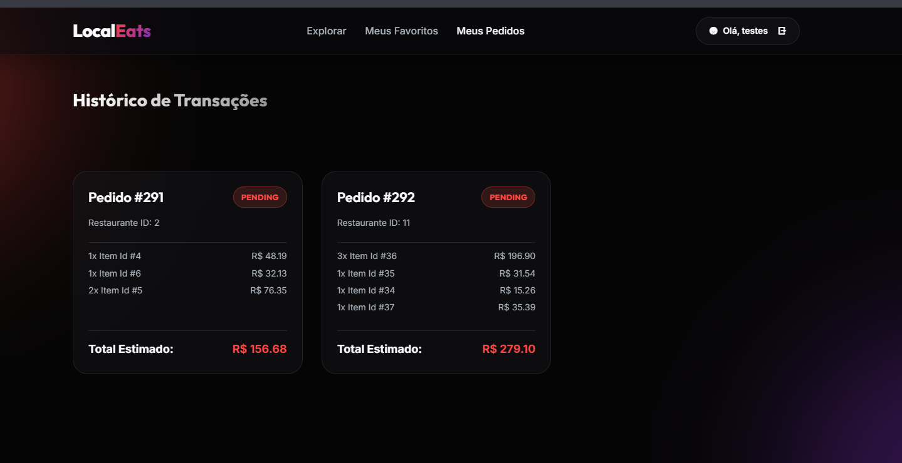
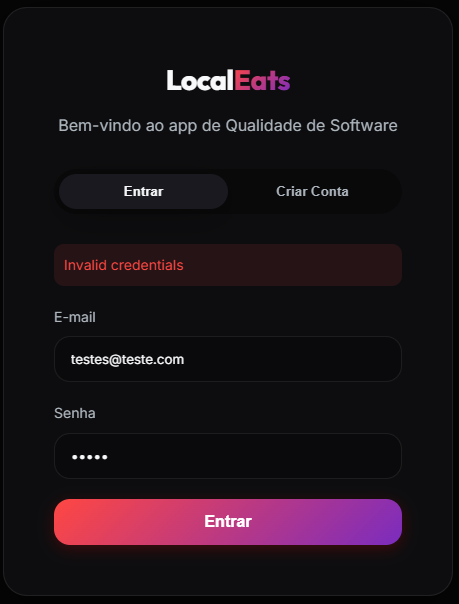
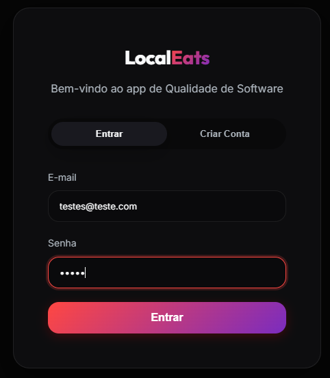

**TAREFA 1**

| Tipo      | Necessidade                                                                       | Interessado |       Consequência se não foratendida                     |
| --------- | --------------------------------------------------------------------------------- | ----------- | --------------------------------------------------------- |
| Explícita | O usuário deve conseguir pesquisar restaurantes por Culinaria ou localização.     | Usuário     | Sera mais dificil de encotra o restaurante que queira.    |
| Explícita | O usuário deve conseguir favoritar restaurantes.                                  | Usuário     | Vai ser dificil encontrar um restaurante que você gostou. |
| Implícita | Os dados da conta do usuário devem ser protegidos.                                | Usuário     | Dados podem ser expostos ou acessados indevidamente.      |
| Implícita | O sistema deve responder em tempo adequado às ações do usuário.                   | Usuário     | A experiência pode ficar lenta e frustrante.              |

**TAREFA 2**

| Integrante | Funcionalidade | O que foi realizado | O que foi observado | Evidência |
|------------|----------------|----------------------|---------------------|-----------|
| Pedro Nunes | Pedido | Foi realizado varios pedidos em uma loja com varios itens e realizado o pedido | Com o pedido finalizado ele foi para o  tela de meus pedidos e ja consta no histórico de transações  |  |

| Integrante | Funcionalidade | O que foi realizado  | O que foi observado  observado | Evidência                     |
| ---------- | -------------- | ------------------------------------------------------------------------------------------ | 
| João Lucas | Login          | Foi realizado login com dados válidos e, posteriormente, uma tentativa com senha inválida. | Com os dados válidos o acesso foi realizado. Com senha inválida, o sistema apresentou mensagem informando que as credenciais estavam incorretas. |  |

**TAREFA 3**

| Integrante | Requisito de Qualidade | Característica ou subcaracterística | Justificativa | Como avaliar|
| ---------- | ---------------------- | ----------------------------------- | ------------- | ----------- |
| Pedro Nunes | Ao realizar um pedido ele tem que aparecer na pagina dos meus pedidos | Redirecionamento Pós-Envio/Feedback de Conclusão de Estado | Ao poder ver seu historico fica melhor para ver quanto gastou ou qual foi o ultimo restaurante que pediu. | Realizar tentativas de varios pedidos diferentes para ver se todos vão para tela de Meus Pedidos. |

| Integrante | Requisito de  Qualidade| Característica ou subcaracterística| Justificativa| Como avaliar|  -------------------------------------------------------------------------------------------------------------------------------------- |
| João Lucas | Ao informar credenciais inválidas no login, o sistema deve apresentar uma mensagem compreensível indicando que não foi possível realizar o acesso. | Usabilidade / reconhecibilidade ou proteção contra erros do usuário | Uma mensagem clara permite que o usuário compreenda por que não conseguiu acessar o LocalEats e saiba que precisa revisar os dados informados. | Realizar tentativas de login com diferentes credenciais inválidas e observar se o sistema apresenta mensagens claras e compreensíveis. |